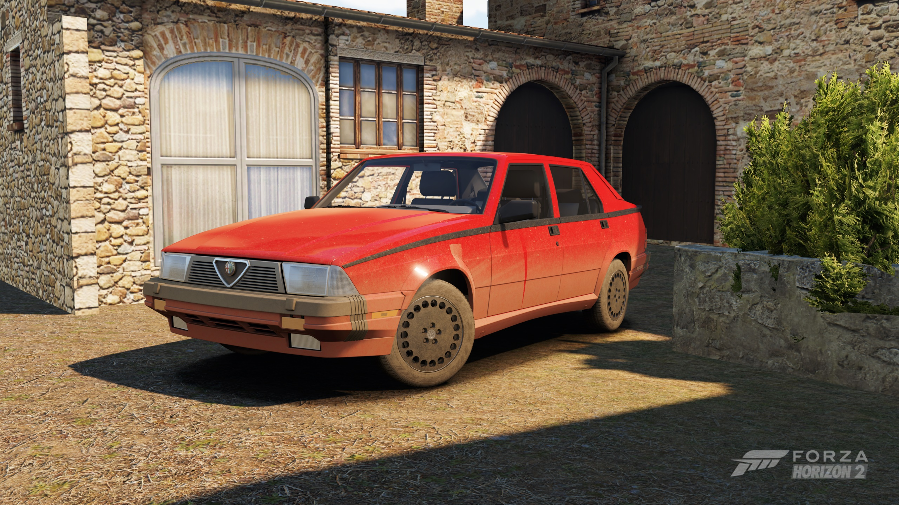
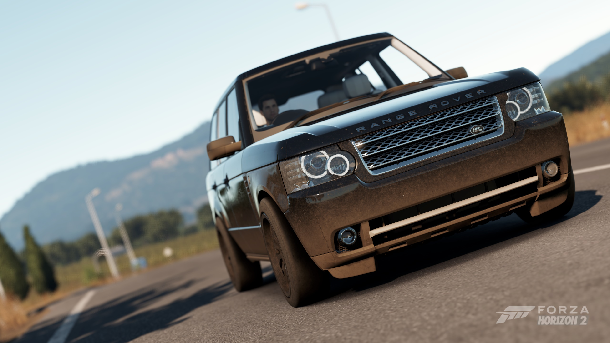
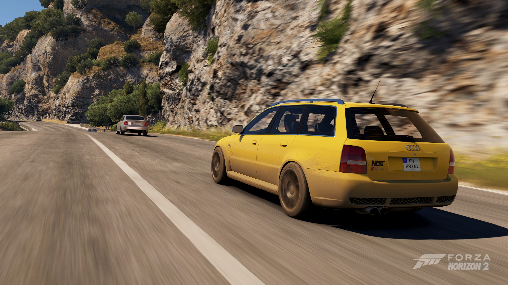

# DirtPersistence

Dirt and mud stay visible on cars for longer in **Forza Horizon 2** (Azimuth). Built on the **FH2 Mod Platform**. It's cosmetic: vehicle handling and the game's save data are unchanged by the mod.


## Screenshots

<p align="center">
  
  
  
  
</p>

## What it does

- **Reduced Dirt and Mud Fade (10x):** applies only 10% of each reduction in the game's simulated dirt and mud coverage, while allowing new dirt and mud to accumulate immediately.
- **Permanent Dirt and Mud:** retains the highest visible coverage recorded for each tracked vehicle, preventing normal fading and allowing heavier coverage to replace it.
- Settings apply live, without restarting the game.
- Automatic GitHub release checks are enabled through the mod platform.

## Installation

1. Make sure Azimuth and the [FH2 Mod Platform](https://github.com/Trinculo54/fh2-mod-platform) are installed. Use a current compatible platform release (the source was developed against the API 9 header).
2. Download `DirtPersistence.dll` from [Releases](https://github.com/FuuX/DirtPersistence/releases), or build it from source using the instructions below.
3. Close Azimuth and copy the DLL into the `fh2-mods` folder next to `azimuth.exe`. Create the folder if it does not exist.
4. Launch Forza Horizon 2 and open **Pause > Settings > MODS > YOUR MODS > DirtPersistence**.

Your installation should look like this:

```text
Azimuth/
├── azimuth.exe
├── DWrite.dll             (FH2 Mod Platform on recent Azimuth builds)
└── fh2-mods/
    └── DirtPersistence.dll
```

Install the platform loader appropriate for your Azimuth version. Older builds may use `d3dcompiler_47.dll` instead. Do not replace a newer working platform with an older one.

To uninstall the mod, close Azimuth and remove only `DirtPersistence.dll` from `fh2-mods`. Its optional INI file can also be removed.

## Settings

Settings are saved in `fh2-mods\DirtPersistence.ini` when changed (assuming the DLL uses its default filename).

| Setting | Range | Default |
|---|---|---|
| Reduced Dirt and Mud Fade (10x) | On / Off | On |
| Permanent Dirt and Mud | On / Off | Off |

Permanent Dirt and Mud takes priority when both settings are enabled. Turn both off to restore normal visual dirt and mud behavior. Changing either setting clears the mod's tracked coverage history.

## Known limits

- Dirt retention is visual only; it does not change grip, physics or damage.
- Coverage is stored in memory, not in the game's save files. It does not persist between game sessions and may reset when switching vehicles or loading new areas.
- The mod tracks vehicle presentation objects, including non-player vehicles. Reused object addresses may retain coverage from a previous object. The tracking table holds up to 2,048 objects.
- The 10x setting scales individual reductions; it is not a fixed tenfold increase in real-world drying time.
- Compatibility with every other mod has not been verified (should be fine with most popular mods).

## How it works

The mod hooks two vehicle presentation functions through the FH2 Mod Platform:

- `CarPresentation::SetDirtAmount` (`0x13A9C40`)
- `CarPresentation::SetMudAmount` (`0x13AB9D0`)

It tracks incoming and displayed coverage separately for each channel. In reduced-fade mode, increases are applied immediately and decreases are scaled by 0.1. In permanent mode, the highest tracked coverage is retained. A lock protects the shared tracking table.

The original functions receive the adjusted values. The game's executable file and assets are not rewritten on disk.

## Building with Zig

### Requirements

- **Zig 0.15.1 (recommended)** — [Download Zig](https://ziglang.org/download/). Make sure Zig is available on your system PATH.
- Git (optional if downloading the source files manually).
- `FH2_DirtPersistence.cpp` from this repository.
- `fh2mod.h` from the FH2 Mod Platform's `include` directory (compatible API 9 header).
- Windows x64.

Visual Studio, MSVC and CMake are not required. Zig provides the necessary C++ compiler, Windows headers and linker.

### Compile

Place `fh2mod.h` in the same directory as `FH2_DirtPersistence.cpp`.

Open PowerShell in the source directory and run:

```powershell
zig version
New-Item -ItemType Directory -Force build | Out-Null
zig c++ -target x86_64-windows-gnu -shared -O2 -std=c++17 -I. FH2_DirtPersistence.cpp -o build/DirtPersistence.dll
```

Once the build is complete, copy `build/DirtPersistence.dll` into the `fh2-mods` directory inside your Azimuth installation.

Launch Forza Horizon 2 and configure the mod under **MODS > YOUR MODS > DirtPersistence**.


## Troubleshooting

If the mod does not appear or has no effect, check `fh2-mods\platform.log` or the latest log under `fh2-mods\platform-logs` for the `DirtPersistence` entries. Look for `DirtPersistence hooks installed` or errors such as `EXE byte mismatch; hooks NOT installed`.

Report issues with your Azimuth version, FH2 Mod Platform version and relevant log entries using [GitHub Issues](https://github.com/FuuX/DirtPersistence/issues).
